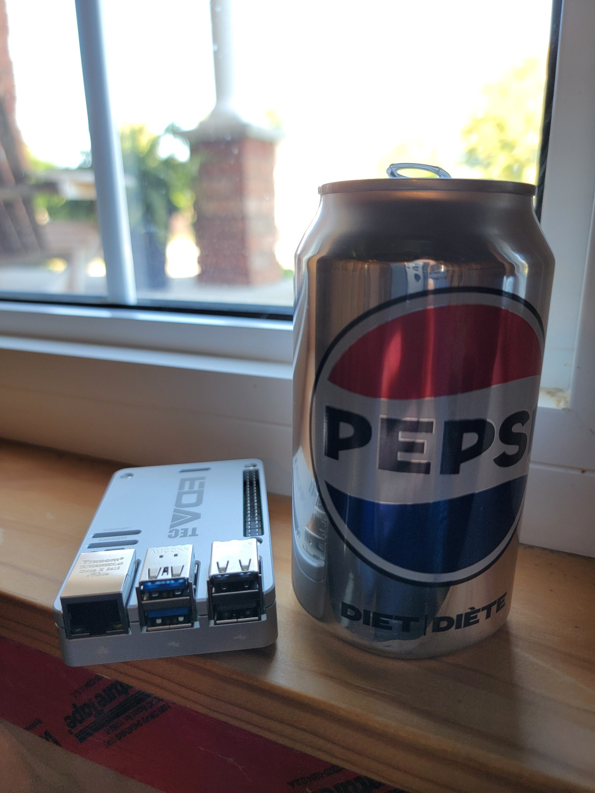

# BillsPi

**Provisioning, hardening, and maintenance scripts for Raspberry Pi 5.**

BillsPi builds on the official Raspberry Pi OS Lite (64-bit) image to configure a headless Linux system. It brings account and SSH policy, system configuration, networking, memory management, scheduled updates, and diagnostics into a readable collection of scripts.

The goal is a Pi that is easier to set up, inspect, maintain, and troubleshoot. BillsPi is primarily written in Bash, with Python tools for offline diagnostics.

## Download

**[Download BillsPi 1.0.0.54 — development preview](https://github.com/DeanWoodside13/BillsPi/releases)**

Under **Assets**, download `billspi-1.0.0.54.zip` and the separate `PrepareBillsPi.sh` preparation helper. The optional `billspi-shutdown-diagnostics.py` supplement is also available.

Use the attached `billspi-1.0.0.54.zip` package for preparation. GitHub's automatic “Source code (zip)” and “Code → Download ZIP” archives include an enclosing directory that the preparation helper does not accept.

Read the preparation requirements below before running the helper.

<p align="center">
  
  <br />
  <em>BillsPi test hardware: Raspberry Pi 5 in a passive cooling case, with a soda can for scale.</em>
</p>

[Report a bug or suggest an improvement](https://github.com/DeanWoodside13/BillsPi/issues) · [MIT license](LICENSE)

## Project status and tested baseline

BillsPi is an active development project. SSH configuration and the installation workflow for other users are still being refined. Start with a spare card and keep access to a local console while testing.

**Current development preview: `1.0.0.54`.** This version adds copyright notices and MIT license identifiers to the source files, plus the full MIT `LICENSE`. The executable code is unchanged from `1.0.0.53`.

Version `1.0.0.54` has passed static comparison and syntax checks. The documented end-to-end hardware-tested baseline remains `1.0.0.53`, shown below; a separate end-to-end hardware test of `.54` has not yet been documented.

| Component | Maintainer-tested baseline |
| --- | --- |
| Hardware | Raspberry Pi 5 |
| BillsPi | `1.0.0.53` |
| Operating system | Raspberry Pi OS Lite, 64-bit, Debian 13 “Trixie” |
| OS image | `2026-10-06-raspios-trixie-arm64-lite.img.xz` |

Other Pi models and OS images are outside this documented test baseline. Package repositories can change after an image is released, so record package and kernel versions when reporting a problem.

## What BillsPi includes

| Area | Included functionality |
| --- | --- |
| Provisioning | Numbered phases, saved progress, reboot handling, and persistent installation logs |
| Security configuration | Account/PAM policy, kernel/sysctl settings, SSH configuration, and reduction of unnecessary services |
| Integrity and logging | AIDE file-integrity checks, auditd rules, persistent journald, and sudo logging |
| Service sandboxing | A helper for applying systemd restrictions to a chosen service; it requires explicit service arguments |
| Networking | BBR/fq and TCP tuning, interface settings, and Realtek RTL8156-family adapter handling; jumbo frames default to off |
| Memory and power | ZRAM setup, MGLRU settings where supported by the kernel, and power-related configuration |
| Maintenance | Twice-daily security and selected Raspberry Pi package updates, monthly full upgrades, and cleanup |
| Troubleshooting | A live-Pi collector, an offline collector, and a shutdown-focused diagnostic supplement |

The scripts also install CLI, development, and profiling tools. The runner selects files named `NN-*.sh`, including those whose filenames describe tools as optional; there is not yet a general profile selector. Unnumbered files such as `good-wrappers.sh` and `luks.sh` are not automatically executed.

These features describe configuration performed by the code. Performance gains depend on the hardware and workload; published benchmark results are still to come.

## How provisioning works

`billspi-setup.service` starts `billspi-runner`. The runner discovers the 22 numbered phase scripts, executes them in order, and records the last completed filename in `/var/lib/billspi/current`.

When a phase requests a reboot, provisioning resumes from the saved progress on the next boot. On completion, the runner creates `/var/lib/billspi/setup.done` and disables the setup service. The main transcript is stored at `/var/log/billspi/install.log`.

Saved progress supports continuing an installation; it does not mean that manually rerunning any phase is harmless. Some phases change access settings, replace configuration, or choose new values.

## Preparing a test card

`PrepareBillsPi.sh` is a separate Ubuntu companion tool; it is **not included in `billspi-1.0.0.54.zip`**. Obtain it in addition to the release archive for the workflow below. It reads the archive's preparation template, stages it privately, and leaves the original ZIP unchanged.

Use the packaged release archive, with `PrepBill.sh`, `billspi-runner`, `billspi-setup.service`, `phases/`, and `tools/` at its root. An archive that places these inside a containing directory will be rejected by the helper. A repository snapshot ZIP is therefore not necessarily interchangeable with the release package.

**This tool erases and reflashes its selected card. The current version is tailored to the maintainer's test setup, rather than a general disk-selection installer.** Its requirements include:

- An interactive Ubuntu terminal, run as your normal user with `sudo` available.
- A writable USB disk initially at `/dev/sda`, identified as `SD Transcend`, approximately 32 GB. The helper checks its identity and mount state before flashing.
- The BillsPi ZIP and the tested OS image in the same directory. Use the official OS image and verify its published checksum separately; the helper's `xz -t` checks compressed-file integrity.
- A private account-settings file containing quoted `PI_USER` and `PI_PASS_PLAIN` assignments. The helper rejects the placeholder password `changeme`. Keep this file out of version control.
- An existing matching `~/.ssh/id_ed25519` key pair. Only the public key is copied to the Pi card.
- The configured `KNOWN_IP` address active on the Ubuntu host. Edit the `KNOWN_IP` assignment near the top of `PrepareBillsPi.sh` to your host's IPv4 address; its supplied value is `192.168.2.12`. This setting is not an environment-variable override.

Read the helper's instructions first:

```bash
bash PrepareBillsPi.sh --help
```

For a setup matching those requirements, run from the directory containing the helper and release ZIP:

```bash
BILLSPI_ACCOUNT_SOURCE="/absolute/path/to/private-account-settings.sh" \
  bash PrepareBillsPi.sh billspi-1.0.0.54.zip
```

The account-settings path above must be replaced with your own path. If you omit the override, the helper expects `~/Desktop/Pi/billspi-1.0.0.53/PrepBill.sh`. This `.53` directory is the helper's existing account-settings default; it does not select the release ZIP. The helper uses the ZIP supplied on the command line.

Follow the removal/reinsertion prompt for the same card. After reinsertion, the helper rechecks the card, stages the public key, updates the SSH phase's permitted client address, and verifies the runner, setup service, and logging configuration. Wait for its final `READY` message before moving the card to the powered-off Pi. Connect Ethernet, then boot the Pi to begin provisioning.

If your card or host does not match the helper's assumptions, stop and review the preparation workflow. Do not run the archived `PrepBill.sh` directly as a substitute: it writes to a fixed disk path without the companion helper's preflight checks.

SSH uses a dynamically selected port in this version. From a local Pi console, inspect `/root/ssh_port.log` or `/var/log/ssh_setup.log` to find it. Confirm your key, permitted client address, and connection before relying on remote-only access.

## Checking installation progress

Run these on the Pi:

```bash
sudo journalctl -u billspi-setup.service --no-pager
sudo tail -n 100 /var/log/billspi/install.log
sudo cat /var/lib/billspi/current
sudo test -f /var/lib/billspi/setup.done && echo "Provisioning completed"
```

The completion marker indicates that the runner reached the end of its phases. Verify the services and access you intend to use as well.

## Diagnostic tools

| File | Run it on | Purpose and prerequisites |
| --- | --- | --- |
| `tools/billspi-diagnostics.sh` | The live Pi | Run with `sudo` after setup completes or stops. Collects installation logs and system state. Requires at least 256 MiB free in `/var/tmp` for staging. Accepts an existing output directory; defaults to `/var/tmp`. |
| `tools/billspi-offline-diagnostics.py` | Ubuntu | Run with `sudo`; requires Python 3.9+. The ext4 root and vfat boot partitions must already be mounted read-only at separate, non-nested mountpoints; root also needs `noload`/`norecovery`. Use an existing writable output directory outside the card, on another filesystem with at least 256 MiB free. |
| `billspi-shutdown-diagnostics.py` | Ubuntu | Collect shutdown-related evidence, especially swap/ZRAM and watchdog state. Run with `sudo`; requires a completed BillsPi installation, Python 3.9+, `journalctl`, and the Pi root partition already mounted read-only with `noload`/`norecovery`. Output must be in an existing directory within your Ubuntu home, on the same filesystem as that home directory. |

`PrepareBillsPi.sh` and `billspi-shutdown-diagnostics.py` are separate companion files, absent from the `1.0.0.54` ZIP. The two tools under `tools/` are included in the ZIP.

For the live collector, the installed path is:

```bash
sudo bash /usr/local/lib/billspi/tools/billspi-diagnostics.sh
```

The collectors produce local reports and do not upload them. Read each tool's usage instructions before running it. Redaction is best-effort: inspect reports for personal information or credentials before sharing them. A successfully created report does not mean every diagnostic check passed.

**Source-hash reporting in `.54`:** The live diagnostic collector still compares installed source files with its `1.0.0.53` reference hashes. The new copyright headers change those files' hashes, so `billspi-source-hashes.tsv` reports `DIFFERENT` for the header-modified files. This does not stop collection and is separate from the release ZIP's checksum. Other unexpected changes or errors still need review.

## Configuration and current limitations

- Some internal version messages and helper descriptions still refer to `1.0.0.53`. Include the downloaded archive filename when reporting a problem.
- Settings currently live in individual scripts and environment variables; there is no single central configuration file yet.
- Service-specific systemd sandboxing needs an explicit service target. The unattended runner skips that helper when no target is supplied.
- Update schedules use the Pi's timezone: lists at 05:30/17:30, upgrades at 06:00/18:00, and a monthly full upgrade on the first day at 02:00 with up to 45 minutes of randomized delay. These timers are persistent, so missed runs can occur after the next boot.
- Provisioning can reboot automatically between phases. After setup, scheduled unattended upgrades have automatic reboot disabled, and the monthly upgrade service only logs package reboot recommendations. Review update logs and arrange reboots when needed.
- There is no complete uninstall or rollback command. Keep a backup or a known-good card before experimenting.
- LUKS encryption is a roadmap item, not an implemented installation feature.

## Contributing

Testing, bug reports, documentation improvements, and focused pull requests are welcome. Useful first contributions include making preparation portable across devices, improving SSH setup, expanding hardware testing, and documenting measured results.

When reporting a problem, include the BillsPi version, OS image, Pi model, relevant storage/network hardware, the phase or command involved, expected behavior, and the actual error. Share reviewed log excerpts rather than an uninspected diagnostic archive. Explain how you tested a proposed code change, particularly if it affects boot, networking, authentication, or updates.

## License and maintainer

BillsPi's original source is available under the [MIT License](LICENSE). Third-party software installed or downloaded by BillsPi remains subject to its own licenses.

Created and maintained by [Dean William Woodside](https://github.com/DeanWoodside13).
